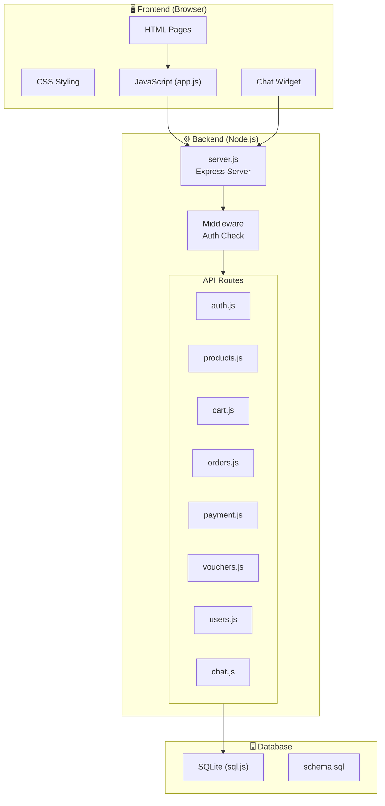
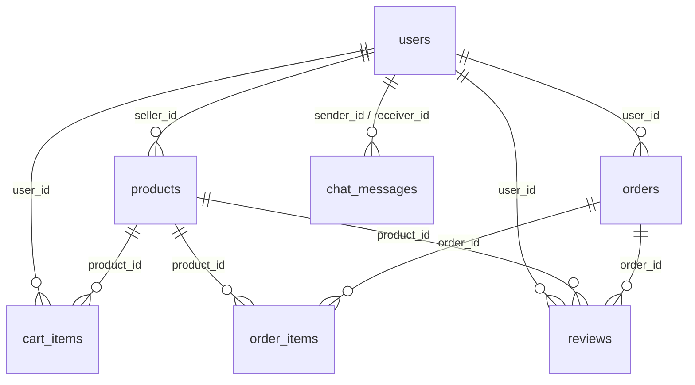
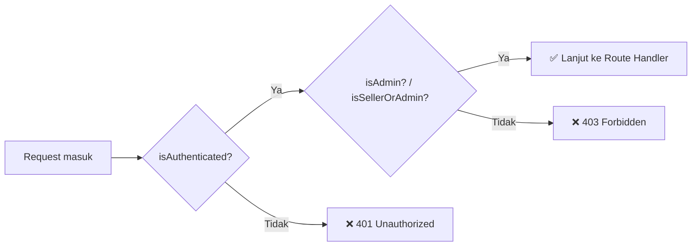
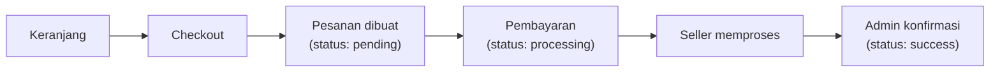

# 📄 Dokumentasi Lengkap Project STOREU
## Platform Digital Entertainment — Kelompok 9

**Mata Kuliah:** Digital Entrepreneurship  
**Tahun:** 2024  
**Teknologi:** Node.js, Express.js, SQLite (sql.js), HTML/CSS/JavaScript  

---

## 📑 DAFTAR ISI

1. [Gambaran Umum Project](#1-gambaran-umum-project)
2. [Arsitektur Sistem](#2-arsitektur-sistem)
3. [Struktur Folder Project](#3-struktur-folder-project)
4. [File Konfigurasi](#4-file-konfigurasi)
5. [Backend — Server Utama](#5-backend--server-utama)
6. [Database — Skema & Inisialisasi](#6-database--skema--inisialisasi)
7. [Middleware — Otentikasi](#7-middleware--otentikasi)
8. [Routes — API Endpoints](#8-routes--api-endpoints)
9. [Frontend — Halaman HTML](#9-frontend--halaman-html)
10. [Frontend — JavaScript (Logika Aplikasi)](#10-frontend--javascript-logika-aplikasi)
11. [Frontend — CSS (Desain & Styling)](#11-frontend--css-desain--styling)
12. [Deployment — Vercel](#12-deployment--vercel)
13. [Fitur-Fitur Utama](#13-fitur-fitur-utama)
14. [Akun Demo](#14-akun-demo)
15. [Kesimpulan](#15-kesimpulan)

---

## 1. Gambaran Umum Project

**STOREU** adalah platform e-commerce digital entertainment yang menjual produk-produk digital seperti **Games, Film, Musik, dan eBook**. Platform ini dibangun sebagai project tugas mata kuliah Digital Entrepreneurship.

### Konsep Bisnis:
- **Marketplace digital** yang menghubungkan penjual (seller) dengan pembeli (user)
- Mendukung **multi-role**: Admin, Seller, dan User
- Sistem pembayaran terintegrasi (demo) dengan e-wallet (GoPay, OVO, DANA, ShopeePay) dan bank transfer
- Sistem voucher diskon untuk promosi
- Live chat antara user dan admin untuk customer support

---

## 2. Arsitektur Sistem



### Alur Kerja Sistem:
1. **User** mengakses halaman web (HTML) melalui browser
2. **JavaScript (app.js)** mengirim request API ke **server.js**
3. **server.js** meneruskan request melalui **middleware** (cek autentikasi)
4. **Routes** memproses logic bisnis dan berinteraksi dengan **database SQLite**
5. Response dikirim kembali ke browser dan ditampilkan ke user

---

## 3. Struktur Folder Project

```
project web1/
├── server.js              ← Server utama Express.js
├── package.json           ← Konfigurasi npm & dependencies
├── package-lock.json      ← Lock file dependencies
├── vercel.json            ← Konfigurasi deployment Vercel
├── database.sqlite        ← File database SQLite
├── sql-wasm.wasm          ← WebAssembly engine untuk sql.js
├── index.html             ← Halaman utama (homepage)
│
├── database/
│   ├── schema.sql         ← Skema tabel database
│   └── init.js            ← Inisialisasi & seed data database
│
├── middleware/
│   └── auth.js            ← Middleware autentikasi & otorisasi
│
├── routes/
│   ├── auth.js            ← API Register, Login, Logout
│   ├── products.js        ← API CRUD Produk & Review
│   ├── cart.js             ← API Keranjang Belanja
│   ├── orders.js          ← API Pesanan & Checkout
│   ├── payment.js         ← API Metode Pembayaran
│   ├── vouchers.js        ← API Voucher Diskon
│   ├── users.js           ← API Manajemen User
│   └── chat.js            ← API Live Chat
│
├── public/
│   ├── css/
│   │   └── style.css      ← Stylesheet utama (Design System)
│   ├── js/
│   │   ├── app.js         ← Logic utama frontend
│   │   └── chat-widget.js ← Widget live chat floating
│   ├── login.html         ← Halaman login
│   ├── register.html      ← Halaman registrasi
│   ├── product.html       ← Halaman detail produk
│   ├── cart.html           ← Halaman keranjang belanja
│   ├── checkout.html      ← Halaman checkout & pembayaran
│   ├── orders.html        ← Halaman riwayat pesanan
│   ├── invoice.html       ← Halaman invoice/struk
│   ├── admin/
│   │   ├── dashboard.html ← Dashboard admin
│   │   ├── products.html  ← Manajemen produk (admin)
│   │   ├── orders.html    ← Manajemen pesanan (admin)
│   │   ├── users.html     ← Manajemen user (admin)
│   │   ├── vouchers.html  ← Manajemen voucher (admin)
│   │   ├── revenue.html   ← Laporan pendapatan (admin)
│   │   └── chat.html      ← Live chat admin
│   └── seller/
│       ├── index.html     ← Dashboard seller
│       ├── products.html  ← Manajemen produk (seller)
│       └── orders.html    ← Pesanan masuk (seller)
```

---

## 4. File Konfigurasi

### 4.1 `package.json` — Konfigurasi NPM

| Point Penting | Penjelasan |
|---|---|
| **name: "storeu"** | Nama project npm |
| **version: "1.0.0"** | Versi pertama project |
| **main: "server.js"** | File entry point utama saat `npm start` |
| **scripts.start** | Menjalankan `node server.js` untuk production |
| **scripts.dev** | Menjalankan `node server.js` untuk development |

### Dependencies (Library yang Digunakan):

| Library | Versi | Fungsi |
|---|---|---|
| **express** | ^4.18.2 | Framework web server Node.js |
| **express-session** | ^1.17.3 | Manajemen session/sesi user |
| **bcryptjs** | ^2.4.3 | Enkripsi (hashing) password |
| **cors** | ^2.8.5 | Mengizinkan Cross-Origin Resource Sharing |
| **sql.js** | ^1.10.0 | SQLite database engine berbasis WebAssembly |

---

## 5. Backend — Server Utama

### 5.1 `server.js` — Express Server
File ini adalah **pusat/otak** dari seluruh backend STOREU.

#### Point-Point Penting:
| Point | Penjelasan |
|---|---|
| **Express App** | Membuat instance aplikasi Express (`const app = express()`) |
| **Port 3000** | Server berjalan di port 3000 secara default (`PORT = process.env.PORT \|\| 3000`) |
| **Error Handling Global** | Menangkap `unhandledRejection` dan `uncaughtException` agar server tidak crash |
| **Trust Proxy** | Diaktifkan saat di-deploy ke Vercel agar session berjalan dengan benar |
| **CORS** | Mengizinkan request dari domain lain dengan credentials (cookies) |
| **JSON & URL Encoded** | Middleware bawaan Express untuk membaca body request JSON dan form data |
| **Session Management** | Menggunakan `express-session` dengan secret key, session berlaku 24 jam |
| **Serverless Session Bridge** | Mekanisme khusus agar session tetap berfungsi di environment serverless (Vercel). Session dipulihkan dari custom header (`x-user-id`) atau cookie (`storeu_uid`) |
| **Database Initialization** | Database diinisialisasi saat server pertama kali berjalan (`initDatabase()`) |
| **Static Files** | File di folder `public/` disajikan secara otomatis (CSS, JS, gambar, HTML) |
| **Route Registration** | Semua API route didaftarkan dengan prefix ganda: `/api/xxx` dan `/xxx` |
| **Global Error Handler** | Menangkap semua error yang tidak tertangani di route dan mengirim response 500 |
| **Vercel Export** | Server di-export sebagai module (`module.exports = app`) agar bisa digunakan sebagai Vercel Serverless Function |

#### API Routes yang Terdaftar:
| Path | File Route | Fungsi |
|---|---|---|
| `/api/auth` | `routes/auth.js` | Autentikasi (login, register, logout) |
| `/api/products` | `routes/products.js` | CRUD produk & review |
| `/api/cart` | `routes/cart.js` | Keranjang belanja |
| `/api/orders` | `routes/orders.js` | Pesanan & checkout |
| `/api/payment` | `routes/payment.js` | Metode pembayaran |
| `/api/users` | `routes/users.js` | Manajemen user |
| `/api/vouchers` | `routes/vouchers.js` | Voucher diskon |
| `/api/chat` | `routes/chat.js` | Live chat |

---

## 6. Database — Skema & Inisialisasi

### 6.1 `database/schema.sql` — Skema Tabel
Database menggunakan **SQLite** melalui library **sql.js** (berbasis WebAssembly, tidak butuh instalasi SQLite terpisah).

#### Tabel-Tabel Database:
| Tabel | Fungsi | Kolom Penting |
|---|---|---|
| **users** | Menyimpan data pengguna | `id`, `username`, `email`, `password` (hashed), `role` (admin/user/seller) |
| **products** | Menyimpan data produk digital | `id`, `name`, `description`, `price`, `category` (game/film/music/ebook), `image_url`, `stock`, `rating`, `seller_id`, `discount_percentage`, `featured` |
| **cart_items** | Menyimpan item di keranjang belanja | `id`, `user_id`, `product_id`, `quantity` |
| **orders** | Menyimpan data pesanan | `id`, `user_id`, `total_amount`, `payment_method`, `payment_status` (pending/processing/success/failed/refunded), `order_code`, `voucher_code`, `voucher_discount` |
| **order_items** | Menyimpan detail item per pesanan | `id`, `order_id`, `product_id`, `quantity`, `price`, `seller_id`, `admin_commission`, `seller_commission`, `fulfillment_status` |
| **vouchers** | Menyimpan data voucher diskon | `id`, `code`, `discount_type` (percentage/fixed), `discount_value`, `min_purchase`, `usage_limit`, `used_count`, `valid_until`, `is_active` |
| **reviews** | Menyimpan ulasan/review produk | `id`, `user_id`, `product_id`, `order_id`, `rating` (1-5), `comment`, `is_anonymous` |
| **chat_messages** | Menyimpan pesan live chat | `id`, `sender_id`, `receiver_id`, `message`, `is_read` |

#### Relasi Antar Tabel:


### 6.2 `database/init.js` — Inisialisasi Database
| Point Penting | Penjelasan |
|---|---|
| **initDatabase()** | Fungsi yang membaca file `database.sqlite` atau membuat database baru jika belum ada |
| **Seed Data** | Data awal (dummy) yang otomatis dimasukkan: 4 akun user, beberapa produk dari setiap kategori, dan 2 voucher |
| **saveDatabase()** | Menyimpan perubahan database ke file `database.sqlite` |
| **getDb()** | Mengembalikan instance database yang sedang aktif |
| **Akun Default** | Admin (`admin@storeu.com`), User (`user1@storeu.com`), Gamer (`gamer99@storeu.com`), Seller (`seller1@storeu.com`) |
| **Voucher Default** | `WELCOME10` (diskon 10%), `STOREU25` (diskon Rp 25.000) |

---

## 7. Middleware — Otentikasi

### 7.1 `middleware/auth.js`
Middleware adalah fungsi yang berjalan **sebelum** request sampai ke route handler. Digunakan untuk mengecek apakah user sudah login dan memiliki izin akses.

| Fungsi | Penjelasan | Digunakan Di |
|---|---|---|
| **isAuthenticated** | Mengecek apakah user sudah login (ada `session.userId`). Jika belum, return error 401 (Unauthorized) | Cart, Orders, Checkout, Review, Chat |
| **isAdmin** | Mengecek apakah user adalah Admin. Cek dari session role atau database. Jika bukan, return error 403 (Forbidden) | Dashboard Admin, Manajemen User, Voucher, Revenue |
| **isSellerOrAdmin** | Mengecek apakah user adalah Seller atau Admin. Memungkinkan keduanya mengakses fitur produk | CRUD Produk |

#### Alur Kerja Middleware:


---

## 8. Routes — API Endpoints

### 8.1 `routes/auth.js` — Autentikasi
| Endpoint | Method | Fungsi | Penjelasan |
|---|---|---|---|
| `/api/auth/register` | POST | Registrasi user baru | Menerima username, email, password. Password di-hash dengan bcrypt. Mendukung role user dan seller |
| `/api/auth/login` | POST | Login user | Menerima username & password. Membandingkan hash password. Membuat session |
| `/api/auth/logout` | POST | Logout user | Menghapus session dan cookies (`storeu_uid`, `storeu_role`) |
| `/api/auth/me` | GET | Cek user saat ini | Mengembalikan data user yang sedang login berdasarkan session |

#### Keamanan:
- Password **tidak pernah** disimpan dalam bentuk teks biasa (plain text)
- Menggunakan **bcrypt** dengan salt round 10 untuk hashing
- Session disimpan di server-side, bukan di browser

### 8.2 `routes/products.js` — Manajemen Produk
| Endpoint | Method | Middleware | Fungsi |
|---|---|---|---|
| `/api/products` | GET | - | Daftar semua produk (filter: category, search, featured, sort, seller_id) |
| `/api/products/:id` | GET | - | Detail satu produk |
| `/api/products` | POST | isSellerOrAdmin | Tambah produk baru |
| `/api/products/:id` | PUT | isSellerOrAdmin | Update produk |
| `/api/products/:id` | DELETE | isSellerOrAdmin | Hapus produk |
| `/api/products/:id/reviews` | GET | - | Daftar review produk |
| `/api/products/:id/reviews` | POST | isAuthenticated | Tambah review (harus sudah membeli) |

#### Fitur Sorting:
- `price_asc` — Harga termurah
- `price_desc` — Harga termahal
- `rating` — Rating tertinggi
- `newest` — Produk terbaru

### 8.3 `routes/cart.js` — Keranjang Belanja
| Endpoint | Method | Fungsi |
|---|---|---|
| `/api/cart` | GET | Lihat isi keranjang user |
| `/api/cart` | POST | Tambah item ke keranjang |
| `/api/cart/:id` | PUT | Update jumlah item |
| `/api/cart/:id` | DELETE | Hapus item dari keranjang |
| `/api/cart/sync` | POST | Sinkronisasi keranjang client-side ke database |

> **Point Penting:** Cart memiliki **dual-layer storage** — data disimpan di `localStorage` browser (client-side) DAN di database server. Ini memastikan keranjang tetap ada meskipun server restart (serverless cold start).

### 8.4 `routes/orders.js` — Pesanan
| Endpoint | Method | Fungsi |
|---|---|---|
| `/api/orders/checkout` | POST | Proses checkout dari keranjang menjadi pesanan |
| `/api/orders` | GET | Daftar pesanan user |
| `/api/orders/:id` | GET | Detail pesanan |
| `/api/orders/admin/all` | GET | Semua pesanan (admin only) |
| `/api/orders/:id/status` | PUT | Update status pesanan (admin) |
| `/api/orders/seller` | GET | Pesanan untuk seller |
| `/api/orders/:id/fulfill` | PUT | Seller memproses pengiriman |
| `/api/orders/admin/revenue` | GET | Laporan pendapatan (admin) |

#### Alur Pesanan:


#### Sistem Komisi:
- **Admin commission:** 10% dari harga jual
- **Seller commission:** 90% dari harga jual

### 8.5 `routes/payment.js` — Pembayaran
| Endpoint | Method | Fungsi |
|---|---|---|
| `/api/payment/methods` | GET | Daftar metode pembayaran tersedia |
| `/api/payment/process` | POST | Proses pembayaran (demo) |
| `/api/payment/confirm` | POST | Konfirmasi pembayaran (demo) |

#### Metode Pembayaran yang Didukung:
| Tipe | Metode |
|---|---|
| **E-Wallet** | GoPay, OVO, DANA, ShopeePay |
| **Bank Transfer** | BCA VA, BNI VA, Mandiri VA, BRI VA |
| **Kartu** | Credit Card (Visa, Mastercard, JCB) |
| **QRIS** | Scan QR universal |

> **Catatan:** Ini adalah mode demo. Pembayaran disimulasikan tanpa koneksi ke payment gateway asli.

### 8.6 `routes/vouchers.js` — Voucher Diskon
| Endpoint | Method | Middleware | Fungsi |
|---|---|---|---|
| `/api/vouchers` | GET | isAdmin | Daftar semua voucher |
| `/api/vouchers` | POST | isAdmin | Buat voucher baru |
| `/api/vouchers/:id/toggle` | PUT | isAdmin | Aktifkan/nonaktifkan voucher |
| `/api/vouchers/:id` | DELETE | isAdmin | Hapus voucher |
| `/api/vouchers/apply` | POST | isAuthenticated | Terapkan voucher saat checkout |

#### Validasi Voucher:
1. Cek apakah voucher **aktif** (`is_active`)
2. Cek apakah voucher **belum kedaluwarsa** (`valid_until`)
3. Cek apakah **kuota penggunaan** masih tersisa
4. Cek apakah total belanja memenuhi **minimum pembelian**

### 8.7 `routes/users.js` — Manajemen User
| Endpoint | Method | Middleware | Fungsi |
|---|---|---|---|
| `/api/users` | GET | isAdmin | Daftar semua user (admin only) |

### 8.8 `routes/chat.js` — Live Chat
Menyediakan API untuk sistem live chat real-time antara user/seller dengan admin.

| Fitur | Penjelasan |
|---|---|
| Kirim pesan | User/seller mengirim pesan ke admin |
| Terima pesan | Admin membalas pesan ke user/seller |
| Riwayat chat | Melihat history percakapan |
| Status baca | Menandai pesan sudah dibaca |

---

## 9. Frontend — Halaman HTML

### 9.1 `index.html` — Homepage
| Bagian | Penjelasan |
|---|---|
| **Promo Banner** | Banner promosi di bagian atas halaman dengan gradient warna |
| **Navbar** | Navigasi utama: logo STOREU (icon `store` dari Lucide), menu Home/Katalog/Kategori, tombol Login/Register |
| **Hero Section** | Bagian pembuka dengan headline "Semua Hiburan Digital Dalam Genggaman", badge, dan CTA button |
| **Kategori** | 4 card kategori: Games, Film & Series, Musik, eBook — masing-masing dengan icon Lucide |
| **Produk Unggulan** | Grid produk yang ditandai `featured=1`, dimuat secara dinamis via API |
| **Katalog Lengkap** | Grid semua produk dengan fitur: search, filter kategori, sorting |
| **Footer** | Informasi brand, link kategori, link akun, link bantuan, copyright |
| **SEO** | Meta description, title tag, favicon (🏪) |
| **Lucide Icons** | Library icon modern dimuat dari CDN, dengan MutationObserver untuk auto-update |

### 9.2 `public/login.html` — Halaman Login
| Point | Penjelasan |
|---|---|
| Form login dengan field username dan password |
| Validasi client-side sebelum kirim ke server |
| Setelah login berhasil, data user disimpan di `localStorage` (`storeu_user`) |
| Redirect otomatis berdasarkan role: admin → `/admin/dashboard.html`, seller → `/seller/index.html`, user → `/` |

### 9.3 `public/register.html` — Halaman Registrasi
| Point | Penjelasan |
|---|---|
| Form dengan field username, email, password, dan pilihan role (User/Seller) |
| Validasi: password minimal 6 karakter |
| Setelah register berhasil, langsung login dan redirect |

### 9.4 `public/product.html` — Detail Produk
| Point | Penjelasan |
|---|---|
| Menampilkan info lengkap: gambar, nama, harga, diskon, rating, platform, developer, deskripsi |
| Tombol "Tambah ke Keranjang" |
| Section review/ulasan dari pembeli |
| Dynamic title sesuai nama produk |

### 9.5 `public/cart.html` — Keranjang Belanja
| Point | Penjelasan |
|---|---|
| Daftar semua item di keranjang dengan gambar, nama, harga, quantity |
| Bisa update jumlah atau hapus item |
| Checkbox untuk memilih item mana yang akan di-checkout |
| Perhitungan total belanja otomatis |
| Tombol "Checkout" yang menyimpan data ke `sessionStorage` |

### 9.6 `public/checkout.html` — Halaman Checkout
| Point | Penjelasan |
|---|---|
| Menampilkan ringkasan item yang akan dibeli |
| Pilihan metode pembayaran (e-wallet, bank transfer, kartu, QRIS) |
| Input kode voucher dengan validasi real-time |
| Perhitungan: subtotal, diskon voucher, total akhir |
| Simulasi proses pembayaran |
| Setelah berhasil, tampilkan konfirmasi sukses |

### 9.7 `public/orders.html` — Riwayat Pesanan
| Point | Penjelasan |
|---|---|
| Daftar semua pesanan user dengan kode order, tanggal, status, total |
| Detail item per pesanan |
| Fitur review: bisa tulis ulasan untuk produk yang sudah dibeli |
| Statistik: total pesanan, total pengeluaran, pesanan selesai |

### 9.8 `public/invoice.html` — Invoice/Struk
| Point | Penjelasan |
|---|---|
| Halaman cetak invoice/struk pembayaran |
| Menampilkan: kode order, tanggal, item, harga, diskon, total, metode pembayaran |
| Tombol print untuk mencetak |

### 9.9 Halaman Admin (`public/admin/`)
| Halaman | Fungsi |
|---|---|
| **dashboard.html** | Ringkasan statistik: total produk, user, pesanan, pendapatan. Grafik dan chart |
| **products.html** | CRUD produk: tambah, edit, hapus, toggle featured |
| **orders.html** | Kelola pesanan: lihat detail, update status (pending → processing → success) |
| **users.html** | Daftar semua user, lihat role dan tanggal registrasi |
| **vouchers.html** | Kelola voucher: buat, aktifkan/nonaktifkan, hapus |
| **revenue.html** | Laporan pendapatan: total revenue, komisi admin, komisi seller |
| **chat.html** | Live chat admin: balas pesan dari user dan seller |

### 9.10 Halaman Seller (`public/seller/`)
| Halaman | Fungsi |
|---|---|
| **index.html** | Dashboard seller: statistik produk dan pesanan |
| **products.html** | Kelola produk milik seller sendiri (tambah, edit, hapus) |
| **orders.html** | Pesanan masuk: lihat pesanan yang mengandung produk seller, proses pengiriman |

---

## 10. Frontend — JavaScript (Logika Aplikasi)

### 10.1 `public/js/app.js` — Core Application Logic
File ini adalah **inti logika frontend** STOREU. Berisi semua fungsi utama yang digunakan di seluruh halaman.

| Komponen | Penjelasan |
|---|---|
| **API Object** | Wrapper untuk `fetch()` dengan auto-attach headers (`x-user-id`, `x-user-role`), credentials, dan error handling |
| **AppState** | State global aplikasi: `user` (data user login) dan `cartCount` (jumlah item keranjang) |
| **CartStore** | Client-side cart storage menggunakan `localStorage`. Fungsi: `addItem`, `removeItem`, `updateQty`, `clear`, `getCount`, `sync` |
| **ChatCache** | Client-side chat cache menggunakan `localStorage`. Mendukung sinkronisasi antar tab browser |
| **ReviewStore** | Client-side review storage agar review tetap terlihat meskipun database belum sync |
| **showToast()** | Fungsi notifikasi toast: success ✅, error ❌, info ℹ️, warning ⚠️ |
| **formatRupiah()** | Format angka ke mata uang Rupiah (contoh: `Rp 150.000`) |
| **getCategoryIcon()** | Mengembalikan icon Lucide sesuai kategori (game→store, film→clapperboard, dll) |
| **initNavbar()** | Inisialisasi navbar: scroll effect, scroll spy, mobile toggle, user dropdown |
| **updateNavUI()** | Update tampilan navigasi sesuai status login (tombol Login/Register atau avatar user) |
| **checkAuth()** | Mengecek status autentikasi dari cache dan server |
| **logout()** | Proses logout: hapus session, bersihkan localStorage/sessionStorage, redirect ke login |
| **addToCart()** | Menambahkan produk ke keranjang (client-side + background server sync) |
| **renderProductCard()** | Membuat HTML card produk: gambar, nama, developer, harga, diskon, rating, tombol cart |
| **initScrollAnimations()** | Animasi scroll dengan IntersectionObserver |

### 10.2 `public/js/chat-widget.js` — Live Chat Widget
| Point | Penjelasan |
|---|---|
| **Floating button** | Tombol chat melayang di pojok kanan bawah |
| **Chat window** | Jendela chat dengan header "Admin STOREU", area pesan, dan input |
| **Unread badge** | Badge notifikasi pesan belum dibaca |
| **Cross-tab sync** | Sinkronisasi pesan antar tab browser menggunakan `localStorage` event |
| **Auto-polling** | Mengecek pesan baru setiap 5 detik |

---

## 11. Frontend — CSS (Desain & Styling)

### 11.1 `public/css/style.css` — Design System
File CSS ini mendefinisikan **seluruh sistem desain** STOREU.

| Aspek | Detail |
|---|---|
| **Design Theme** | "Warm Paper & Editorial Charcoal" — minimalis, editorial, premium |
| **Font** | `Plus Jakarta Sans` (heading), `Inter` (body) — dari Google Fonts |
| **Warna Utama** | `#f6f5f0` (background paper), `#18181b` (ink/text), `#ffffff` (card) |
| **Warna Aksen** | `#a16207` (warm amber), `#15803d` (green), `#b91c1c` (red) |
| **Gradient** | Charcoal gradient (`#18181b → #27272a`) |
| **Border** | Soft paper edges (`#e7e5de`) |
| **Shadow** | Natural shadow tanpa glow neon |
| **Border Radius** | 6px (sm), 10px (md), 14px (lg), 20px (xl) |
| **Transition** | 0.15s (fast), 0.25s (normal), 0.4s (slow) |
| **Navbar Height** | 68px |

#### Komponen CSS yang Didefinisikan:
- Navbar & Brand logo
- Glass Card (efek glassmorphism)
- Product Card & Grid
- Hero Section dengan dekoratif glow
- Category Tabs & Badges
- Button system (primary, secondary, sizes)
- Toast notifications
- Forms & Input
- Modal & Dropdown
- Footer
- Admin Sidebar & Dashboard
- Responsive breakpoints
- Animasi scroll (`animate-in`)

---

## 12. Deployment — Vercel

### 12.1 `vercel.json`
| Point | Penjelasan |
|---|---|
| **version: 2** | Menggunakan Vercel platform v2 |
| **functions** | Mendefinisikan serverless function di `api/index.js` yang meng-include file database, schema, dan sql.js |
| **rewrites** | Semua request ke `/api/*` diarahkan ke serverless function `api/index.js` |

### Cara Kerja di Vercel:
1. File HTML/CSS/JS di `public/` di-serve sebagai static files
2. Semua API request (`/api/*`) ditangani oleh serverless function
3. Database SQLite berjalan di memori (via sql.js WebAssembly)

---

## 13. Fitur-Fitur Utama

| No | Fitur | Penjelasan |
|---|---|---|
| 1 | **Multi-Role System** | 3 role: Admin (kelola semua), Seller (jual produk), User (beli produk) |
| 2 | **Katalog Produk** | 4 kategori (Game, Film, Musik, eBook) dengan search, filter, dan sorting |
| 3 | **Keranjang Belanja** | Dual-layer storage (client + server), real-time update |
| 4 | **Checkout & Pembayaran** | Multi-metode pembayaran (e-wallet, bank, kartu, QRIS) |
| 5 | **Sistem Voucher** | Voucher diskon persentase atau nominal tetap dengan validasi lengkap |
| 6 | **Manajemen Pesanan** | Alur lengkap dari checkout → pembayaran → pengiriman → selesai |
| 7 | **Review & Rating** | User bisa tulis ulasan dan rating setelah membeli produk |
| 8 | **Live Chat** | Chat real-time antara user/seller dengan admin |
| 9 | **Dashboard Admin** | Statistik, manajemen produk/user/voucher/pesanan, laporan pendapatan |
| 10 | **Dashboard Seller** | Statistik penjualan, kelola produk, proses pesanan masuk |
| 11 | **Invoice/Struk** | Cetak struk pembayaran |
| 12 | **Responsive Design** | Tampilan optimal di desktop dan mobile |
| 13 | **SEO Optimized** | Meta description, title tags, semantic HTML |
| 14 | **Deployment Ready** | Siap deploy ke Vercel dengan konfigurasi serverless |

---

## 14. Akun Demo

| Role | Username | Password | Akses |
|---|---|---|---|
| **Admin** | `admin` | `admin123` | Dashboard admin, kelola semua |
| **User** | `user1` | `user123` | Belanja, keranjang, pesanan, chat |
| **User** | `gamer99` | `user123` | Belanja, keranjang, pesanan, chat |
| **Seller** | `seller1` | `seller123` | Dashboard seller, kelola produk, pesanan masuk |

---

## 15. Kesimpulan

**STOREU** adalah platform e-commerce digital entertainment yang dibangun dengan arsitektur **full-stack JavaScript**:

- **Backend:** Node.js + Express.js sebagai REST API server
- **Database:** SQLite via sql.js (WebAssembly) — ringan, portable, tanpa instalasi tambahan
- **Frontend:** HTML + CSS + Vanilla JavaScript — tanpa framework frontend (React/Vue), sehingga lebih mudah dipahami
- **Deployment:** Siap deploy ke Vercel sebagai serverless function

Platform ini mendemonstrasikan konsep **Digital Entrepreneurship** dengan implementasi fitur lengkap marketplace digital, mulai dari katalog produk, keranjang belanja, sistem pembayaran, manajemen multi-role, hingga customer support via live chat.

---

> **Dibuat oleh Kelompok 9 — Mata Kuliah Digital Entrepreneurship**  
> **Platform:** STOREU — Digital Entertainment Platform  
> **Tahun:** 2024
